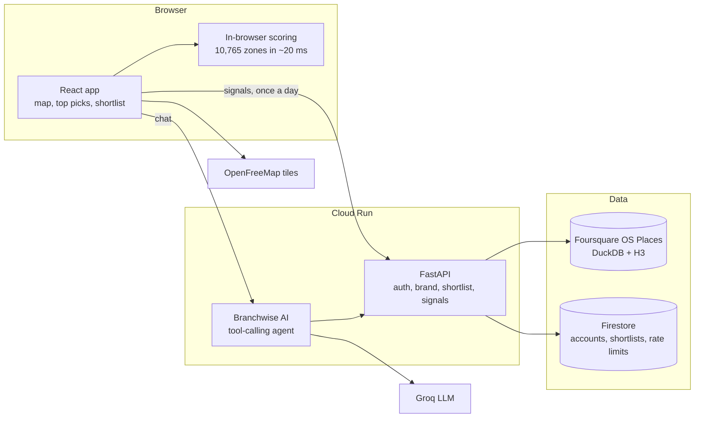

# Branchwise

Branchwise ranks every Sydney neighbourhood for a food and drink brand's next store and explains why, so you can choose before you sign a lease.

**Live:** https://branchwise-564404959706.australia-southeast1.run.app

## Architecture



## Run locally

```bash
uv venv --python 3.12 .venv && uv pip install --python .venv/bin/python -r requirements.txt
cp .env.example .env
.venv/bin/python scripts/prepare_sydney.py && .venv/bin/python scripts/build_signals.py
.venv/bin/uvicorn backend.app.main:app --reload --port 8000
cd frontend && npm install && npm run dev        # http://localhost:5173
```

Tests: `.venv/bin/python -m pytest backend/tests -q`. Deploy: `deploy/cloudrun.sh`.
