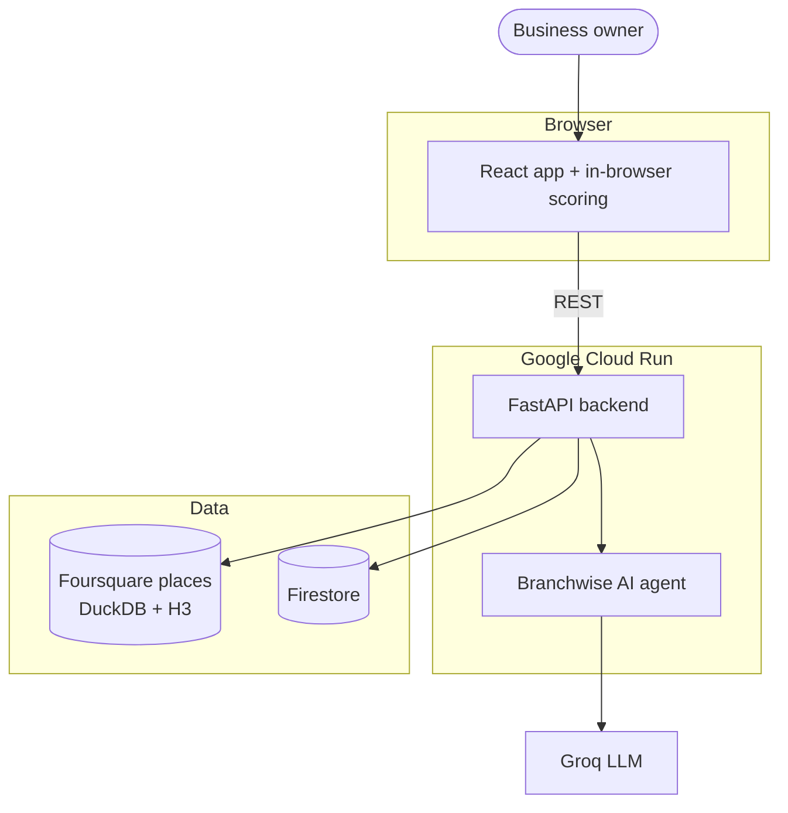
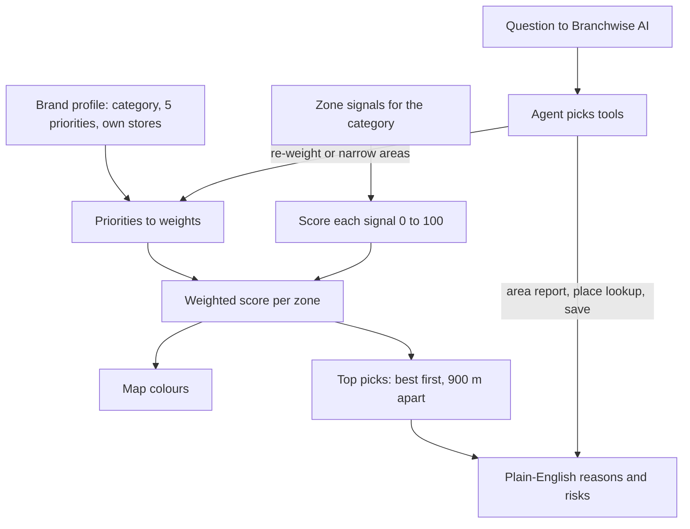

# Branchwise

**Live demo:** [branchwise-564404959706.australia-southeast1.run.app](https://branchwise-564404959706.australia-southeast1.run.app)

A site selection tool for food and drink brands in Sydney. A business describes its brand and what matters to it, and Branchwise ranks every neighbourhood in the city as a place to open its next store, explains each ranking in plain English, and lets you ask an AI assistant to rethink the shortlist.

---

## Problem Statement

Opening a new store is one of the most expensive bets a small food and drink business makes, and the location decides most of it. Large chains pay for location analytics; a mid-sized bubble tea or coffee brand usually picks a suburb from gut feel, a few site visits and whatever lease comes up.

Branchwise gives those businesses the same kind of evidence. It scores **10,765 zones across Sydney** from **155,676 real places** (Foursquare Open Source Places), weighted by what the brand says it cares about: foot traffic, nearby unis and malls, public transport, competitors, and distance from its own stores. Every score comes with the reasons behind it, so you can choose an area before you commit to a lease.

---

## What You Can Do

- **Onboarding:** describe your brand, pick your category, rate five priorities and add your existing stores. Takes about two minutes.
- **Map:** every zone in Sydney coloured by how well it fits your brand. Hover for the score, click for a full area report.
- **Top picks:** the ten best areas, spaced apart so they aren't all on the same street, each with its top reasons and risks.
- **Branchwise AI:** ask in plain English ("somewhere near a uni with less competition") and the assistant re-weights the scores, narrows the areas, looks up places and saves sites, all through the same scoring engine.
- **Shortlist and compare:** save areas with notes and compare them side by side.

---

## System Architecture



**Frontend** (React, served by the backend): onboarding, the map, top picks, shortlist and chat. The browser downloads each category's zone signals once a day and scores the whole city itself in about 20 ms, so re-weighting is instant and costs the server nothing.

**Backend** (Google Cloud Run, Docker): accounts, brand profiles, shortlists, area reports and the assistant. It keeps no state of its own, so it scales from zero to many instances.

**Storage** (Firestore): accounts, brands, shortlists and shared rate limits.

---

## How It Works

When a brand opens the map or changes a priority, the system runs this pipeline:



1. **Signals:** for each H3 zone (about 0.1 km²) the backend counts competitors, complementary venues and shops nearby, and finds the closest anchor (uni, mall, office, hospital) and transit stop. This is computed once per category at build time.
2. **Weights:** the brand's five priorities (0 to 4) become weights. The top levels count extra, so "very important" really dominates.
3. **Score:** each signal becomes a 0 to 100 score on a smooth curve, and the zone's score is their weighted average.
4. **Rank:** the best zones are picked in order, at least 900 m apart, inside the areas the brand chose.
5. **Explain:** each pick gets its strongest reasons ("A bus stop is 78 m away", "No competitors within a 6-minute walk") and any risks.
6. **Ask:** Branchwise AI never invents numbers. It can only act through tools on the same engine, and every score and reason in its answers comes from the engine.

---

## Scoring Model

| Signal | What it measures | Curve |
|--------|------------------|-------|
| Busy streets | Shops and venues within 300 m | 100 · (1 − e^(−n/20)) |
| Near anchors | Closest uni, mall, office or hospital, plus complementary venues | 60% · 100 · e^(−d/700) + 40% · 100 · (1 − e^(−n/6)) |
| Public transport | Closest train, metro or bus stop | 100 · e^(−d/600) |
| Low competition | Same-category venues within 500 m, excluding your own stores | 100 · e^(−n/2.5) |
| Spacing from your stores | Distance to your nearest store | 0 at 200 m, 100 at 1.5 km |

Priorities map to multipliers of 0, 1, 2, 3.5 and 5, normalised to weights that sum to 100%.

**Parity:** the browser and Python implementations are checked against each other zone by zone (`scripts/check_scoring_parity.py`); all 10,765 scores and the top ten picks match exactly.

---

## Dataset

**155,676 places** in Greater Sydney from the Foursquare Open Source Places release of 2026-10-15, grouped into **10,765 H3 resolution-9 zones**. Category matching for six verticals (bubble tea, coffee, fast casual, bakery, dessert, healthy) and nine regions lives in `config/categories.json`. Without a Hugging Face token the prep script generates synthetic data so the app still runs end to end.

---

## Quick Start (Local Development)

### Data

```bash
git clone https://github.com/pranavanand2026-design/Branchwise.git
cd Branchwise
uv venv --python 3.12 .venv && uv pip install --python .venv/bin/python -r requirements.txt
cp .env.example .env                              # add HF_TOKEN and GROQ_API_KEY
.venv/bin/python scripts/prepare_sydney.py        # downloads and filters Sydney places
.venv/bin/python scripts/build_signals.py         # precomputes zone signals
.venv/bin/python scripts/seed_demo.py             # optional demo accounts
```

### API Server

```bash
.venv/bin/uvicorn backend.app.main:app --reload --port 8000
```

### Frontend

```bash
cd frontend
npm install
npm run dev                                        # http://localhost:5173
```

### Deploying

The app runs on Google Cloud Run, built from the root `Dockerfile` (frontend and backend in one container). With the gcloud CLI logged in:

```bash
deploy/cloudrun.sh
```

It scales to zero when idle, so the first request after a quiet spell takes a couple of seconds.

---

## Project Structure

```
Branchwise/
├── Dockerfile                  # One container: built frontend + API (Cloud Run)
├── requirements.txt
├── config/categories.json      # Verticals, Foursquare category matching, regions
│
├── backend/app/                # FastAPI backend
│   ├── main.py                 # App entry, security headers, assistant route
│   ├── auth.py                 # Sign-up, login, password change, delete account
│   ├── brand.py                # Brand profile, signals, rankings, reports, shortlist
│   ├── scoring.py              # Zone signals and the scoring engine
│   ├── assistant.py            # Branchwise AI: Groq tool-calling agent + offline fallback
│   ├── security.py             # Argon2id, signed sessions, CSRF, rate limits
│   ├── db.py                   # DuckDB over the places parquet
│   └── repo/                   # Storage: Firestore (prod) and SQLite (local)
│
├── frontend/                   # React + Vite
│   ├── index.html              # Landing page
│   ├── src/pages/              # Auth, Onboarding, Workspace, Shortlist, Settings
│   ├── src/components/         # Map, Top picks, area report, chat, compare
│   └── src/lib/                # API client, in-browser scoring, state
│
├── scripts/                    # Data prep, signal build, parity check, demo seed
├── backend/tests/              # pytest suite
└── deploy/                     # Cloud Run and hosting scripts
```

---

## Testing

```bash
.venv/bin/python -m pytest backend/tests -q
.venv/bin/python scripts/check_scoring_parity.py
```

Every API test runs twice: once on SQLite and once on an in-memory Firestore stand-in.

| Test | Coverage |
|------|----------|
| `test_full_flow_and_isolation` | Sign-up to onboarding to rankings to shortlist; users can't see each other's data |
| `test_csrf_header_required`, `test_bad_inputs` | CSRF guard and input validation |
| `test_signup_validation`, `test_login_rate_limit` | Password rules and shared rate limiting |
| `test_password_change_and_delete` | Session revocation and full account deletion |
| `test_assistant_*` | Tool-calling loop, offline fallback and request validation |

---

## Tech Stack

| Layer | Technology |
|-------|------------|
| **Data** | Foursquare OS Places, DuckDB, H3, PyArrow |
| **Backend** | FastAPI, Uvicorn, Pydantic, Argon2 |
| **AI** | Groq (gpt-oss-120b) with tool calling |
| **Frontend** | React 18, Vite, MapLibre, deck.gl, Zustand, Tailwind CSS |
| **Storage** | Firestore (production), SQLite (local) |
| **Deployment** | Google Cloud Run (Docker), OpenFreeMap tiles |
